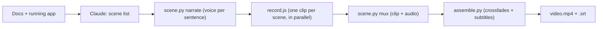

# demo-video

Makes a narrated demo video of a running web application, for viewers who are new to it. The video has intro slides, film-style subtitles, a cursor, spotlights and zooms on what is explained, and smooth transitions.

Everything runs locally: the voice is an offline text-to-speech model (Kokoro), the screens are recorded with Playwright, and ffmpeg joins the result. No text or audio leaves your machine.

For a short video that proves a finished ticket works, use [implementation-video](../implementation-video/README.md). It reuses the scripts in this skill.

## How it works



The video contains:
1. A title slide and a separate agenda slide.
2. Two or three slides that explain the domain.
3. Per screen: a short intro slide, then the screen with a cursor and spotlights on what is explained.
4. A timeline of the plan ahead (if there is a roadmap) and an end slide.

The story comes from the project documentation. Claude narrates only what the app really does, and reports where the app and the documentation differ.

## One-time setup

Run the setup script in this skill folder. It checks and installs what is missing, and is safe to run again.

- macOS / Linux: `bash scripts/setup.sh`
- Windows (PowerShell, untested): `.\scripts\setup.ps1`

You can also ask Claude: "set up demo-video".

It needs ffmpeg, Node.js and Python 3.12 to 3.14. It installs Kokoro, its model files (about 340 MB) and Playwright with Chromium into `~/.local/share/demo-video-tts`. Set `DEMO_VIDEO_HOME` to use another folder.

## Usage

Example prompts for Claude Code:

- "Make a demo video of the app at `http://localhost:3000`."
- "Make a short sample of the first three scenes first."
- "Redo scene 4 with a slower pace."

The video, its subtitles and the working files go to `local/demo/`. Make sure that folder is ignored by git.

## Your own look

The slides use the neutral theme in `theme/` (`theme.css` and `logo.svg`). For a house style, make a folder with your own `theme.css`, logo and fonts, and ask Claude to use it (`--theme <dir>`).

## Files

| File | Purpose |
|---|---|
| `SKILL.md` | Instructions for Claude, including the rules shared with implementation-video |
| `scripts/setup.sh`, `scripts/setup.ps1` | Prerequisite check and install |
| `scripts/scene.py` | Narration per scene, and muxing a clip with its audio |
| `scripts/record.js` | Records a slide or an app screen with cursor, spotlight and zoom |
| `scripts/assemble.py` | Joins the clips with crossfades and burns in the subtitles |
| `theme/` | Neutral slide theme |
| `examples/sample/` | A small invented example: scenes, slides, a pronunciation map and a local demo page |

## Try the example

From this skill folder, after setup:

```bash
V=${DEMO_VIDEO_HOME:-~/.local/share/demo-video-tts}/venv/bin/python; E=examples/sample; C=local/demo/clips
$V scripts/scene.py narrate $E/scenes.json --out $C
for i in t1 t2 a1 e1; do
  node scripts/record.js --scenes $E/scenes.json --clips $C --id $i --base "file://$PWD/$E/app"
  $V scripts/scene.py mux $i $C/$i.webm $(cat $C/$i.offset) --out $C
done
$V scripts/assemble.py --clips $C local/demo/sample.mp4 t1 t2 a1 e1
```

This gives a video of about 20 seconds.
