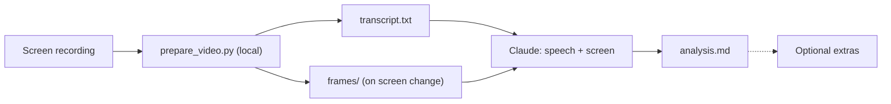

# video-process-extraction

Extracts the process, workflow and requirements of someone's work from a screen recording.

Every statement in the output points to a timestamp in the video. Anything the recording does not show becomes an open question for the person who made the recording.

## How it works



1. The script transcribes the speech and saves a frame on every screen change. This runs locally.
2. Claude reads the transcript and the frames together and corrects speech errors with what is on screen.
3. Claude writes `analysis.md`: steps, inputs, screens, business rules, pain points, requirements and open questions.

## Optional extras

After the analysis, Claude asks which extras you want. You can also ask for them directly, or do them yourself outside the skill.

| Extra | Output | Use |
|---|---|---|
| User journey | `user-journey.md` | English description for a vendor, with a "Must keep working" list to check after each release |
| Compare with docs or code | `comparison.md` | COVERED, MISSING or CONTRADICTION per observation |
| Release check | `release-check.md` | UNCHANGED, CHANGED, REMOVED or UNKNOWN per journey item |
| Recording request mail | draft mail | Asks a colleague to record their work |
| Review request mail | draft mail | Asks the recorder to check the result and answer the open questions |

The mails are only drafts. Claude does not send them.

## One-time setup

The easiest way: after you install the plugin, ask Claude "set up video-process-extraction". Claude knows where the skill is installed and runs the check in step 3. To do it yourself:

1. Install Python 3.10 to 3.14. Python 3.15 does not work yet, because there are no `av` wheels for it.
   Windows: `winget install Python.Python.3.13`.
2. Create a virtual environment and install the packages. Run this in the skill folder:

   ```bash
   python -m venv .venv
   # macOS/Linux: source .venv/bin/activate
   # Windows:     .venv\Scripts\activate
   python -m pip install -r requirements.txt
   ```

3. Check the installation: `python scripts/prepare_video.py --check`.

ffmpeg is not needed. The first transcription downloads the speech model (about 1.6 GB).

## Usage

Example prompts for Claude Code:

- "Analyse the video `<path>`."
- "Analyse the video `<path>` and also write the user journey."
- "Compare the analysis with the docs in `<folder>`."
- "Check the user journey against the release notes in `<file>`."
- "Draft a recording request for `<name>` about `<task>` in `<application>`."

## Output

The output goes to a folder next to the video (or to `--out`):

| File | For | Content |
|---|---|---|
| `transcript.srt`, `transcript.txt` | You | Speech with timestamps |
| `frames/` | You | Screenshots and `index.tsv` (timestamp, reason) |
| `analysis.md` | Own team | Steps, inputs, screens, business rules, pain points, requirements, open questions |
| `user-journey.md` | Vendor | English journey with "Must keep working", pain points and wishes |
| `comparison.md` | Own team | Optional: comparison with docs or code |
| `release-check.md` | Own team and vendor | Optional: journey against a release |

## Files in the skill

| File | Purpose |
|---|---|
| `SKILL.md` | Instructions for Claude |
| `scripts/prepare_video.py` | Makes the transcript and frames |
| `requirements.txt` | Python packages |
| `templates/recording-request-mail.md` | Invitation to the recorder |
| `templates/review-request-mail.md` | Review request to the recorder |
| `templates/analysis-template.md` | Structure of `analysis.md` |
| `templates/user-journey-template.md` | Structure of `user-journey.md` |
| `templates/comparison-template.md` | Structure of `comparison.md` |
| `templates/release-check-template.md` | Structure of `release-check.md` |

Claude writes the mails in the recorder's language.

## Frames and speed

The script saves a frame when at least 1% of the screen changes. There are at least 2 s and at most 15 s between two frames. A 9-minute video gave 79 frames.

- A small change is missing, such as a status-bar message? Use a lower `--threshold`, for example 0.003.
- A moving webcam tile gives too many frames? Raise `--min-gap`.
- `--threshold 0` gives a fixed frame every `--max-gap` seconds.

A 9-minute video took 2.3 minutes on a MacBook (CPU, model `large-v3-turbo`). On a less powerful laptop it can take about the length of the video. Use `--model small` then.

## Privacy

The speech is transcribed locally. The frames go to Claude. Check that the data on screen falls within the policy for Claude use. Ask the recorder to work in a test environment if sensitive data appears on screen.
